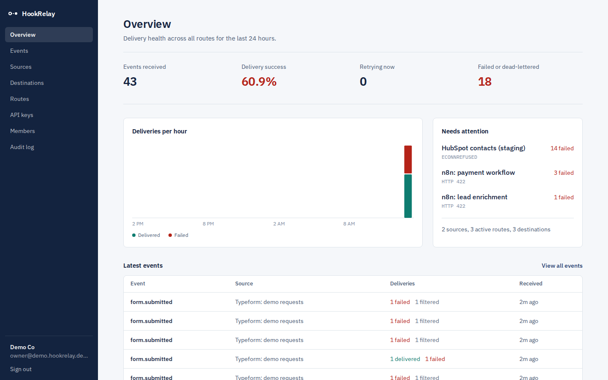
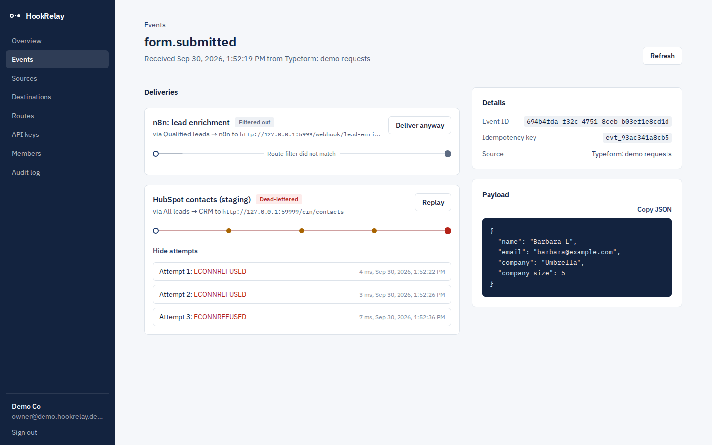
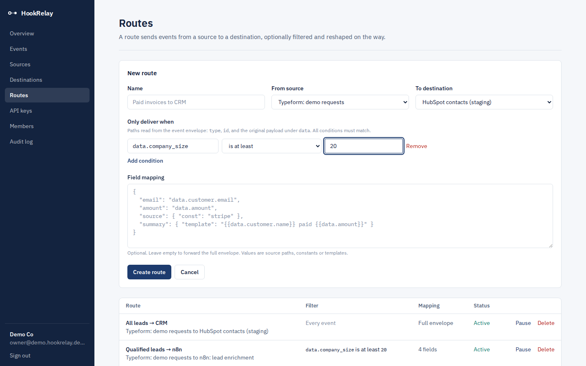
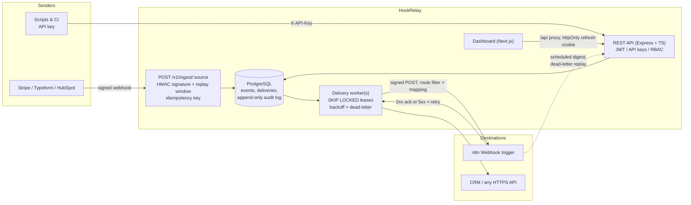

# HookRelay

**Receive, verify, route and reliably deliver webhooks to n8n workflows and SaaS APIs.**

HookRelay sits between the services that send you webhooks (Stripe, Typeform, HubSpot, your own apps) and the places that need to act on them (n8n workflows, CRMs, internal services). Every inbound request is signature-checked, stored idempotently, filtered and reshaped per route, then delivered with retries, exponential backoff and a dead-letter queue. A Next.js dashboard shows every event and every delivery attempt, and an append-only audit log records who changed what.



| Event detail: each dot on the wire is a delivery attempt | Route builder: filters and field mapping |
| --- | --- |
|  |  |

## Why I built it

Most integration bugs aren't in the happy path. They're a provider retrying a webhook you already processed, a CRM returning 503 for ten minutes, a forged request hitting a public URL, or nobody knowing which change broke a workflow. HookRelay is a small, production-shaped answer to those problems, built with the stack and practices used in SaaS integration teams: TypeScript end to end, Next.js, Express, PostgreSQL, n8n, OAuth 2.0 / JWT, and SOC 2-style controls.

## Architecture



**Request lifecycle**

1. A sender POSTs to a source URL. HookRelay verifies `X-HookRelay-Signature: t=<unix>,v1=<hmac>` over the *raw* body with a 5-minute replay window, using the source's secret (stored AES-256-GCM encrypted).
2. The event is stored once per `Idempotency-Key`; duplicates return `200` with the original event id.
3. Each enabled route on that source evaluates its filter conditions. Matching routes get a `pending` delivery; others are recorded as `skipped` so you can see *why* nothing happened.
4. Workers claim due deliveries with `FOR UPDATE SKIP LOCKED` plus a lease, apply the route's field mapping, sign the outgoing body with the destination secret and POST it.
5. `2xx` → delivered. `408/425/429/5xx` or network errors → retried with exponential backoff and jitter (honouring `Retry-After`). Other `4xx` → rejected immediately. After `max_attempts` → dead-lettered, replayable from the UI or API.

## Features

**Integrations and automation**
- Signed webhook intake (HMAC-SHA256, timestamped, secret rotation with dual-signature support)
- Routes with AND-ed filter conditions (`eq`, `in`, `gte`, `contains`, `exists`, ...) and a declarative field mapping (paths, constants, `{{templates}}`)
- Outbound delivery worker: retries, backoff with jitter, `Retry-After`, dead-letter queue, replay, per-attempt history
- Horizontally scalable workers (safe concurrent claiming, tested)
- Three importable [n8n workflows](#n8n-workflows): payment to CRM + Slack + email, error alerting, and a scheduled digest that auto-replays transient dead letters through the API
- Scoped API keys for machine-to-machine use (n8n HTTP Request nodes, scripts, CI)
- OpenAPI 3.1 spec with Swagger UI at `/docs`

**Security** (details in [SECURITY.md](SECURITY.md) and [docs/soc2-controls.md](docs/soc2-controls.md))
- Auth: bcrypt (cost 12) passwords, 15-minute JWT access tokens (algorithm pinned), rotating httpOnly refresh tokens with **reuse detection** that revokes the whole session family
- GitHub **OAuth 2.0** sign-in: authorization code flow with `state` and **PKCE**
- **RBAC** with four least-privilege roles; roles are re-read on every request, so demotions and disables apply instantly; no one can grant a role above their own
- Multi-tenant isolation: every query is scoped to the caller's workspace (covered by tests)
- **SSRF protection** for destinations (private/metadata IP ranges blocked, re-checked at send time, no redirects followed, explicit host allowlist)
- Secrets never stored in plaintext: API keys and refresh tokens are SHA-256 hashed; signing secrets are AES-256-GCM encrypted; all shown to the user exactly once
- **Append-only audit log** enforced by a database trigger; CSV export
- Helmet security headers, strict CSP on the dashboard, rate limiting, zod validation on every input, log redaction of credentials, generic error messages with request ids
- CI: lint, typecheck, tests against real Postgres, `npm audit`, Gitleaks secret scanning, CodeQL, Dependabot; PR template with a security checklist; CODEOWNERS

## Tech stack

| Layer | Choices |
| --- | --- |
| Dashboard | Next.js 16 (App Router), React 19, TypeScript, Tailwind CSS 4 |
| API | Node.js 26, Express 5, TypeScript, zod, pino |
| Data | PostgreSQL 16 (raw SQL via `pg`, forward-only migrations) |
| Auth | JWT, OAuth 2.0 (GitHub, PKCE), API keys, RBAC |
| Automation | n8n (webhook trigger, Code, IF, HTTP Request, Schedule, Error Trigger) |
| Testing | Vitest, Supertest (76 tests, ~87% line coverage) |
| Delivery | Docker (non-root, read-only FS), Docker Compose, GitHub Actions |

## Quick start (Docker)

```bash
git clone https://github.com/Aryan708/hookrelay.git && cd hookrelay
cp .env.example .env
# fill in the four required secrets, e.g.:
for k in POSTGRES_PASSWORD JWT_ACCESS_SECRET ENCRYPTION_KEY N8N_ENCRYPTION_KEY; do
  sed -i "s/^$k=.*/$k=$(openssl rand -hex 32)/" .env
done
docker compose up --build
```

- Dashboard: http://localhost:3000 (create a workspace on first visit)
- API docs: http://localhost:4000/docs
- n8n: http://localhost:5678

## Local development

Requires Node 26 (22+ works) and PostgreSQL 16.

```bash
npm install
cp apps/api/.env.example apps/api/.env   # fill in secrets
set -a; . apps/api/.env; set +a
npm run migrate
SEED_PASSWORD='choose-a-long-password' npm run seed   # optional demo workspace + users per role
npm run dev:api     # http://localhost:4000
npm run dev:web     # http://localhost:3000 (proxies /api to the API)
```

## Try it: send a signed webhook

Create a source in the dashboard (copy its secret), a destination (e.g. `http://n8n:5678/webhook/hookrelay-payments` in Docker), and a route between them. Then:

```bash
BODY='{"type":"payment.succeeded","amount":12900,"currency":"usd","customer":{"name":"Ada Lovelace","email":"ada@example.com"}}'
TS=$(date +%s)
SIG=$(printf '%s.%s' "$TS" "$BODY" | openssl dgst -sha256 -hmac "$SOURCE_SECRET" | cut -d' ' -f2)

curl -X POST "http://localhost:3000/api/v1/ingest/$SOURCE_ID" \
  -H "Content-Type: application/json" \
  -H "Idempotency-Key: evt_001" \
  -H "X-HookRelay-Signature: t=$TS,v1=$SIG" \
  -d "$BODY"
# 202 {"id":"…","duplicate":false,"deliveries":[{"routeId":"…","status":"pending"}]}
```

Send it again with the same `Idempotency-Key` and you get `200` with `"duplicate": true`. Change one byte of the body and you get `401`.

Publishing from a script or n8n instead, with a scoped API key:

```bash
curl -X POST http://localhost:4000/v1/events \
  -H "X-API-Key: $HOOKRELAY_API_KEY" -H "Content-Type: application/json" \
  -d '{"sourceId":"'$SOURCE_ID'","type":"lead.created","payload":{"email":"x@example.com"}}'
```

## n8n workflows

Import from `n8n/workflows/` (n8n → Workflows → Import from file, or `n8n import:workflow --input=<file>`). They're also mounted read-only at `/workflows` in the compose stack. Tested on n8n 2.41: a forged request gets `401 mismatch`, a stale one `401 expired`, and a delivery from HookRelay passes verification in the Code node.

| Workflow | What it shows |
| --- | --- |
| `01-payment-to-crm.json` | **Webhook trigger** (raw body kept) → **Code** node verifies the HookRelay HMAC signature with a timing-safe compare → **IF** rejects forgeries with `401` → **HTTP Request** upserts the HubSpot contact → **IF** high-value → Slack alert → SendGrid receipt → `200` ack. HTTP nodes retry 3×; if the workflow still fails, n8n returns `5xx` and HookRelay's backoff retries the whole delivery. |
| `02-error-alerts.json` | **Error Trigger** workflow: formats the failing workflow, node and message and posts it to Slack. Set it as the Error Workflow of the others. |
| `03-daily-digest-and-replay.json` | **Schedule** (weekdays 09:00) → HookRelay API with an API-key credential: fetch 24h stats and dead-lettered events, fan out per event, keep only transient failures (network/5xx/429), **replay** them via `POST /v1/deliveries/:id/replay`, then post a digest to Slack. |

Setup: create two **Header Auth** credentials (`HookRelay API key` → header `X-API-Key`; `HubSpot private app token` / `SendGrid API key` → `Authorization: Bearer …`), and set `HOOKRELAY_DESTINATION_SECRET` (the destination's secret shown once in HookRelay) and `SLACK_WEBHOOK_URL` in the n8n environment. No credentials live in the workflow files; CI fails if one looks hard-coded.

## Roles

| Permission | Viewer | Developer | Admin | Owner |
| --- | :-: | :-: | :-: | :-: |
| Read sources, routes, events | ✓ | ✓ | ✓ | ✓ |
| Manage sources, destinations, routes | | ✓ | ✓ | ✓ |
| Replay deliveries, manage API keys | | ✓ | ✓ | ✓ |
| Manage members, read audit log | | | ✓ | ✓ |

API key scopes are limited to `events:write`, `events:read`, `events:replay`, `sources:read`, `routes:read`. A key can never manage members, keys or read the audit log.

## Testing

```bash
TEST_DATABASE_URL=postgres://postgres@localhost:5432/hookrelay_test npm test
npm run test:coverage -w apps/api
```

76 tests. Integration tests run against a real PostgreSQL database and a local HTTP receiver standing in for n8n, covering among others: refresh-token reuse detection, `alg=none` tokens, privilege escalation attempts, instant demotion, tenant isolation, scoped and revoked API keys, OAuth state mismatch and a full GitHub sign-in with stubbed endpoints, bad / missing / expired signatures, idempotency, filters, field mapping, outgoing signature verification, retry then success, dead-lettering then replay, no retry on permanent 4xx, and no double delivery with three concurrent workers. Unit tests cover the crypto, SSRF guard, mapping (including prototype-pollution attempts), retry policy and RBAC matrix.

## Project structure

```
apps/
  api/                 Express + TypeScript REST API and delivery worker
    migrations/        forward-only SQL migrations (schema, audit trigger)
    openapi.yaml       API contract, served at /docs
    src/
      config/          validated environment (fails fast on bad config)
      lib/             crypto, SSRF guard, transforms, retry policy, RBAC
      middleware/      auth (JWT / API key), audit, validation, errors
      modules/         auth, members, api-keys, sources, destinations, routes, events, insights
      services/        event ingest + fan-out
      worker/          delivery worker (in-process or standalone)
    tests/             unit + integration (real Postgres)
  web/                 Next.js dashboard
n8n/workflows/         importable n8n workflows
docs/                  SOC 2 control mapping, screenshots
.github/               CI, CodeQL, Dependabot, PR template, CODEOWNERS
```

## Design decisions

- **Postgres as the queue.** `SELECT … FOR UPDATE SKIP LOCKED` plus a lease column gives safe concurrent workers without adding Redis or a broker. Event and deliveries are written in one transaction, so an accepted webhook can never be lost between "stored" and "queued". A dedicated broker becomes worth it at much higher volume.
- **Raw SQL over an ORM.** The interesting queries (fan-out, claiming, hourly stats) read better as SQL, and it keeps the runtime image small.
- **Access token in memory, refresh token in an httpOnly cookie.** The dashboard proxies `/api` through Next.js so the cookie stays first-party and the API origin isn't exposed to the browser.
- **Signatures over raw bytes.** Re-serialized JSON can differ from what was signed, so the raw request body is kept for verification on both sides (HookRelay and the n8n Code node).

## Roadmap

- Per-destination custom headers stored encrypted (e.g. bearer tokens for CRMs)
- Transform previews: run a route's filter and mapping against a past event before saving
- OpenTelemetry traces across ingest → worker → destination
- Event retention policy with scheduled purge

## License

MIT
